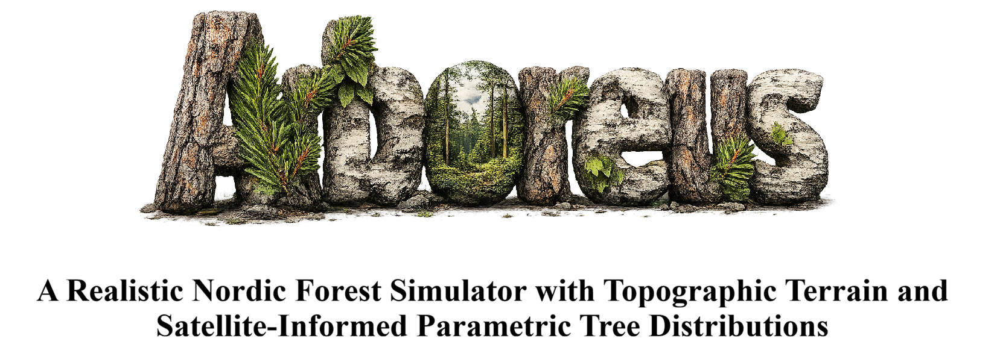
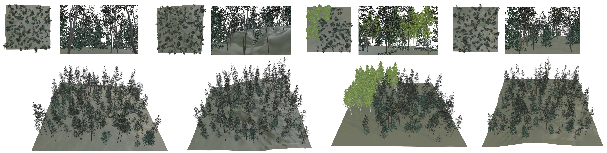
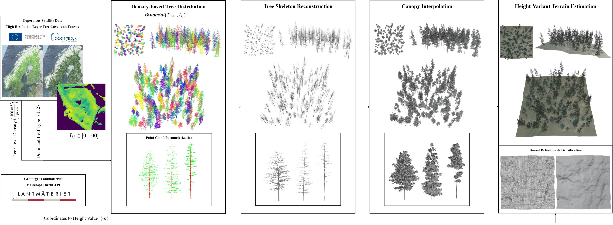

<p align="center">
  
</p>
<p align="center">
  
</p>

This is the code repository of Arboreus, a Nordic forest simulator for rigorous statistical validation of robotic autonomy algorithms in Nordic forest environments. Arboreus presents an automated methodology for rapid synthesis of large-scale forest environments from parametric trees, height-variant terrains and satellite-informed tree density distributions.

## Benchmark Dataset

[](https://doi.org/10.5281/zenodo.24246185)

A benchmark dataset with 25 worlds of size $1000m^2$ from the Jämtön, Mjölkuddsberget and Storforsen Nordic test areas is released with this code repository. This dataset is available at [Zenodo](https://doi.org/10.5281/zenodo.24246185). A visual render map for each environment is included at the branch *benchmark*.

## Citation

If you use Arboreus in your work consider including the citation of this publication.

```
--- Under Review ---
```

## Presentation Video

<p align="center">
  <a href="https://youtu.be/MxL3YVanRlg"></a>
</p>

## Forest Generation

The parametric generation of dominant Nordic tree species such as Birch, Spruce and Pine is guided by trunk, canopy and foliage parameters, extracted from growth studies in the Nordic areas. Tree distribution in an area of interest is based on the Copernicus satellite dataset, which provides tree cover and type densities up to 10m raster resolution. 

The surface generation is guided by topographic data from the Swedish cadastral agency to produce realistic terrains. Given coordinates and extents of forested areas of interest, Arboreus rapidly synthesizes topography and satellite-informed likely replicas and their statistical variants, while offering user-controllability over the quality and dimensionality of trees (age-based).

The current implementation includes as well forest generation without satellite data for ease-of-use outside of Sweden.



### Installation

The repository can be installed as a standalone Python package.

```
python3 -m pip install -e .
pip install bpy==4.0.0 --extra-index-url https://download.blender.org/pypi/
```

### Deployment

The forest generation can be deployed through the bash script _main.sh_; where the tree skeleton, the topographic-based ground and the forest mesh are created. An extract of the script is shown below.

```
# Generate synthetic forest with tree trunks
python3 src/forest.py

# Generate ground mesh from geo-data
python3 src/ground.py

# Transform .ply format to .xyz
python3 src/generator/val/preprocess.py

# Estimate trunk from point cloud
python3 src/generator/val/adtree.py

# Import estimated tree meshes
python3 src/generator/val/blender.py
```

In order to deploy the tree mesh reconstruction tool [AdTree](https://github.com/tudelft3d/AdTree), it is necessary to build both pine and spruce-birch versions. Two modeling versions are used to control the trunk fitting process over the generated tree point clouds.

```
cd src/adtree/pine && mkdir Release && cd Release
cmake -DCMAKE_BUILD_TYPE=Release ..
make

cd src/adtree/spruce-birch && mkdir Release && cd Release
...
```

The Arboreus tool also includes a URDF translator that generates tree and forest URDFs, instead of OBJ meshes. The current deployment script comments these steps.

```
# Build URDF skeletons
python3 src/generator.train/skeleton.py

# Join URDF trees
python3 src/generator.train/merge.py
```

## User Configuration

The user-controllability enables tuning the environments for data collection applications or customization before testing of feature-sensitive autonomy algorithms.

### Forest Parameterization

The parameterization of the forest generation is shown below. The forest type allows generation with or without satellite information. The forest variants indicate the number of environments to generate. The forest size and density define the bounds and tree distribution of the environment.

```
SEED: 123               # Random Seed

FOREST_TYPE: "base"     # OR satellite
FOREST_VARIANTS: 1      # Number of generated environments
FOREST_DENSITY: 0.2     # Trees per m² (Base Generation)
FOREST_SIZE_M2: 1000.0  # Forest Size in m²

TREE_POINTS: 4096       # Points in Generated Point Clouds
TREE_SCALE: 0.5         # Heuristic Forest Age
TREES_DIR: "data"       # Output Directory

TREE_URDF_RADIUS: 0.01  # URDF Base Radius
TREE_URDF_SCALE: 0.001  # URDF Element Scale
```

### Satellite Parameterization

The parameterization of the density and tree types in the satellite generation is defined by the coordinate bounds and the respective satellite TIF files. This repository includes the TIF definition for the presented validation area, however it is possible to download the desired target area as specified in the [Copernicus Documentation](https://documentation.dataspace.copernicus.eu/APIs/S3.html) through the [S3 EOData Service](https://eodata-s3keysmanager.dataspace.copernicus.eu/panel/s3-credentials).

```
SATELLITE_TCD_TIF_PATH: "data/CLMS_HRLVLCC_TCD_S2024_R10m_E48N47_03035_V01_R00.tif"
SATELLITE_DLT_TIF_PATH: "data/CLMS_HRLVLCC_DLT_S2024_R10m_E48N47_03035_V01_R00.tif"

# EPSG:4326 -> WGS84
SATELLITE_WEST_TARGET:  22.1378
SATELLITE_SOUTH_TARGET: 65.6010
SATELLITE_EAST_TARGET : 22.1532
SATELLITE_NORTH_TARGET: 65.6100
```

### Ground Parameterization

Two modes are offered in the ground generation, the base and the satellite forest types. The satellite forest utilizes height information from [Geotorget](https://geotorget.lantmateriet.se/), the service for Swedish cadastral information. The usage of said services requires the creation of an account.

However, an alternate ground generation process is implemented, where a sampled grid adds parallel panels at different filter resolutions and later smooths them; producing uneven grounds.

```
LANTMATERIET_USERNAME: ""
LANTMATERIET_PASSWORD: ""
LANTMATERIET_URL: "https://api.lantmateriet.se/distribution/produkter/markhojd/v1/hojd"

GROUND_VOXEL_SIZE: 0.05 # Voxel Downsampling

# ***************** #
#  Base Generation  #
# ***************** #

GROUND_FILTERS: [                   # Grid Fractions [Width, Height]
      [0.10, 0.10], [0.25, 0.25],
      [0.40, 0.40], [0.55, 0.55], 
      [0.70, 0.70]
    ]
GROUND_SPACING_M: 0.5               # Grid Spacing
GROUND_ANGLE_RANGE: [-20.0, 20.0]   # Filter Angle
GROUND_FILTER_PROBABILITY: 0.5      # Filter Application
GROUND_EDGE_FADE_FRACTION: 0.35     # Filter Smoothing
```
